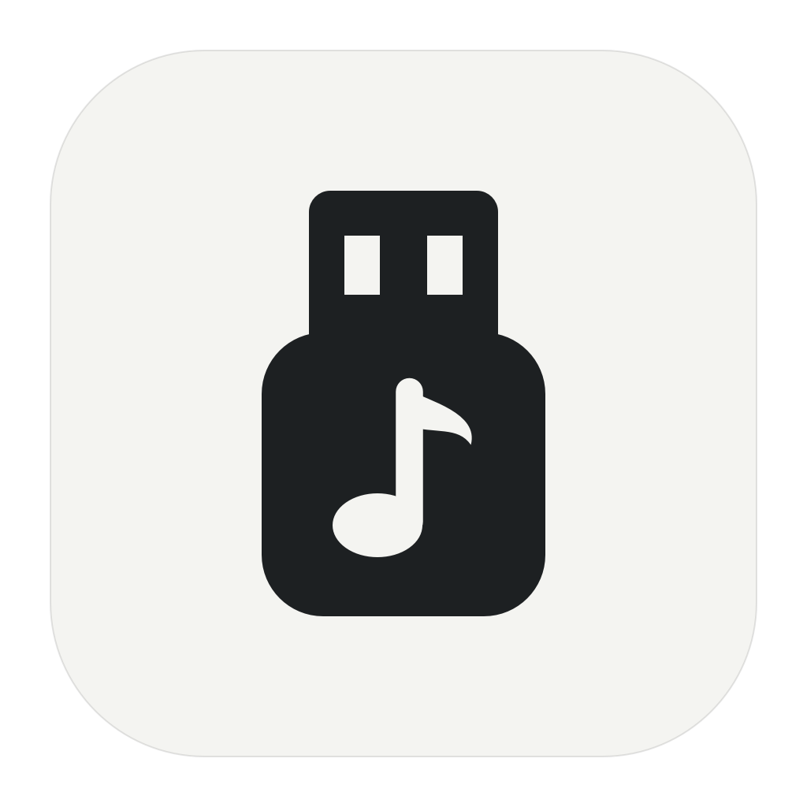
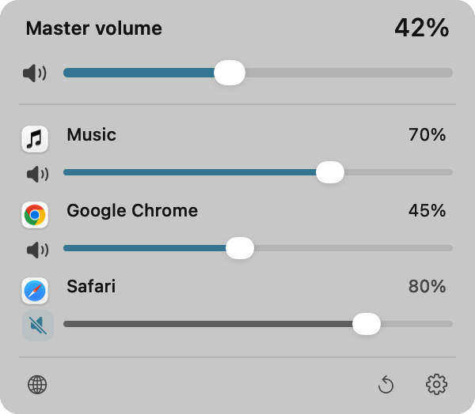
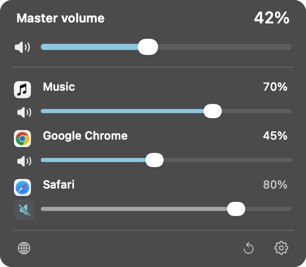
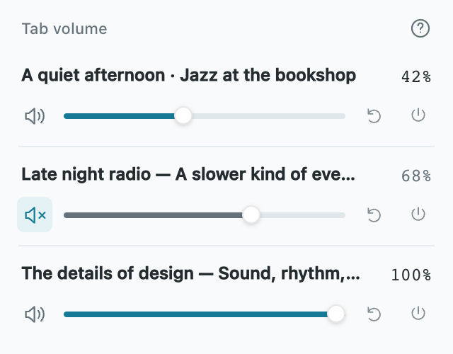

<p align="center">
  
</p>

<h1 align="center">USB Volume</h1>

<p align="center">A small, native volume mixer for USB speakers on Mac.</p>

<p align="center">
  <a href="https://github.com/imboni/usb-volume/releases/tag/v0.3.0">Download v0.3.0</a> ·
  <a href="https://imboni.github.io/usb-volume/">Website</a> ·
  <a href="README.zh-CN.md">简体中文</a> ·
  <a href="https://github.com/imboni/usb-volume/issues">Issues</a>
</p>

<p align="center">
  
  
  <a href="LICENSE"></a>
  <a href="https://github.com/imboni/usb-volume/actions/workflows/build.yml"></a>
</p>

USB speakers sometimes leave the macOS volume control disabled. USB Volume adds a menu bar slider, with independent controls for your audio apps and an optional browser extension for individual tabs. Audio is processed locally, in memory.

<p align="center">
  
  &nbsp;&nbsp;
  
</p>
<p align="center"><sub>Actual native interface with sample audio sources. Light and dark appearances.</sub></p>

## What it does

- **Master volume and mute** for the selected USB speaker.
- **Per-app volume and mute**, remembered when apps reopen. Nested browser helper processes are grouped with their app where identifiable.
- **Per-tab volume** with the included Chrome / Edge extension.
- **A compact, native interface**: 300 px wide, keyboard navigation, accessible controls, and subtle motion that respects Reduce Motion.
- **Automatic USB detection**, standby on disconnect, optional launch at login, media keys, and adjustment feedback.
- **14 languages** in the app, extension, and website, including right-to-left Arabic.

English · 简体中文 · 繁體中文 · 日本語 · 한국어 · Français · Deutsch · Español · Italiano · Português (Brasil) · Русский · العربية · हिन्दी · Bahasa Indonesia

## Install

**Requirements:** macOS 14.2 or later, Apple Silicon, and a stereo USB output device with no input channels. Compatibility varies by device. Release binaries are arm64.

1. [Download USBVolume-0.3.0-arm64.zip](https://github.com/imboni/usb-volume/releases/download/v0.3.0/USBVolume-0.3.0-arm64.zip), unzip it, and move **USB 音量.app** to **Applications**.
2. Open the app. Releases are locally signed, **not notarized by Apple**. If macOS blocks it, choose **Open Anyway** in **System Settings → Privacy & Security**.
3. Connect your USB speaker, enable control, and allow **system audio recording** when prompted.
4. Click the menu bar icon. Start at a low level and adjust.

Media keys separately require Accessibility permission. A locally signed update may require renewed authorization. You can use the on-screen controls without media-key access.

[Release notes](CHANGELOG.md) · [SHA-256 checksums](https://github.com/imboni/usb-volume/releases/download/v0.3.0/SHA256SUMS.txt)

## Use the mixer

| Control | Behavior |
| --- | --- |
| Master slider / speaker button | Adjust or mute the whole selected output. |
| App slider / speaker button | Adjust or mute one app; dragging its slider unmutes that app. |
| Scroll the app list | Browse the list. Hold **Option** while scrolling a slider to adjust it. |
| Reset icon | Restore all saved app levels to 100% and clear app mutes; master volume stays unchanged. |
| Browser icon | Open the browser extension setup guide and included files. |
| Settings icon / right-click menu | Change language, output device, detection, login behavior, and feedback. |

Play audio to let an app appear. Only apps sending audio to the selected output are controllable. Master and app levels combine: **100% app volume adds no attenuation**; lower levels further reduce the master output. App discovery refreshes periodically, so a new process may initially play at the master level before its saved setting is applied.

**Pause playback before quitting or stopping control.** The speaker returns to its original volume and may become louder. If a muted app’s independent route fails, USB Volume mutes the master output and shows an error; clear master mute manually after resolving it. App mute is a convenience control, not a privacy boundary.

## Control individual browser tabs

<p align="center">
  
</p>
<p align="center"><sub>Actual extension popup with sample tabs.</sub></p>

1. Use the app’s browser button to locate the bundled **BrowserExtension** folder, or [download the extension ZIP](https://github.com/imboni/usb-volume/releases/download/v0.3.0/USBVolume-BrowserExtension-0.3.0.zip).
2. Copy or extract the folder to a permanent location.
3. Open `chrome://extensions` or `edge://extensions`, enable **Developer mode**, and choose **Load unpacked**.
4. Open a normal web page, click the extension, and enable control for that tab.

Requires Chrome / Edge **116+**. Tab controls live in the extension popup and are not synchronized into the Mac panel. Master, browser-app, and tab attenuation combine. Tab settings reset after the browser restarts. The extension is distributed as an unpacked companion, not through a browser store.

[Extension guide, permissions, and tests →](BrowserExtension/README.md)

## Compatibility and privacy

- Designed for stereo, output-only USB devices. Multichannel devices, audio interfaces with input channels, and every hardware/browser combination are not guaranteed.
- The native macOS volume slider may remain disabled; use USB Volume’s slider.
- Creating an independent audio route can briefly interrupt playback. Other audio-processing apps may conflict.
- Safari has no per-tab companion. App grouping depends on the audio processes macOS reports, so shared WebKit helpers may appear separately.
- System audio recording permission is needed to read playback and return adjusted audio. **No microphone access, audio files, or audio uploads.** The app has no accounts or telemetry.
- The extension uses local tab capture; browser-internal pages and some protected media cannot be controlled. It processes sound in memory and does not upload it.

If startup stalls, pause playback, quit the app, and reconnect the speaker before retrying. Restarting the macOS audio service interrupts all apps and is a manual troubleshooting step, never an automatic action.

## Build and test

Install Apple Command Line Tools (`xcode-select --install`). The app uses Objective-C, AppKit, and CoreAudio, with no third-party runtime dependencies.

```sh
git clone https://github.com/imboni/usb-volume.git
cd usb-volume
bash build.sh
```

The app is written to `build/USB 音量.app`.

```sh
bash test.sh                                # DSP sanitizers, routes, keys, detection, localization
bash test-ui.sh --all-locales               # Native GUI: 14 languages × light/dark
node --test BrowserExtension/tests/*.test.js # Extension logic and localization
python3 Tests/ReleaseResources.py           # Release metadata, docs, assets, locale parity
bash package-release.sh                    # arm64 app ZIP, extension ZIP, checksums
```

Native UI checks require a logged-in macOS graphical session and use fake audio sources: they do not change the selected speaker. Browser/UI tests require Python Playwright and Chrome; see [CONTRIBUTING.md](CONTRIBUTING.md). These tests do not replace real USB hardware and live tab-capture testing.

The binary also supports read-only `--status` and `--list-devices` diagnostics. The website is static HTML/CSS/JS in `docs/`, published through GitHub Pages.

## Contribute

Bug reports, device compatibility reports, translation improvements, and focused pull requests are welcome. Include your macOS version, USB device, steps to reproduce, and whether another audio processor is running. Remove personal data before attaching diagnostics.

See [CONTRIBUTING.md](CONTRIBUTING.md) for the source map, localization workflow, and tests.

## License

[MIT](LICENSE) · Copyright © 2026 Boni.
