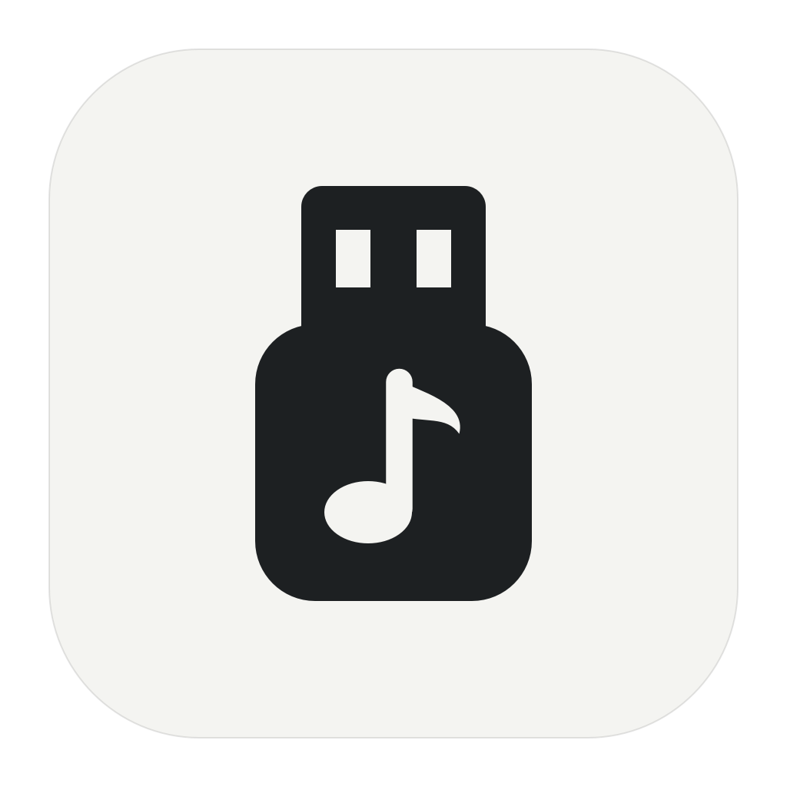
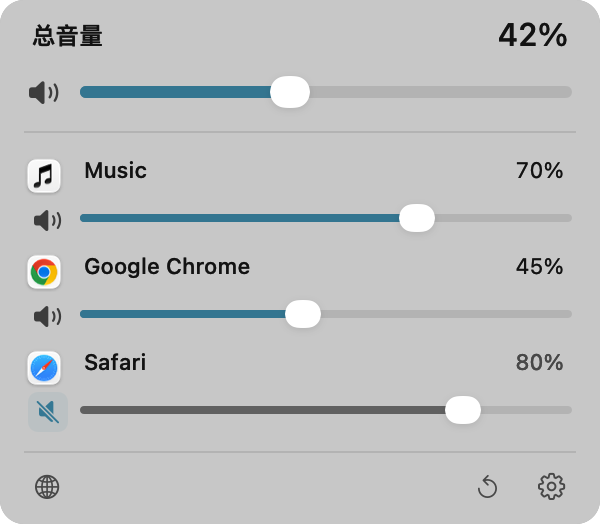
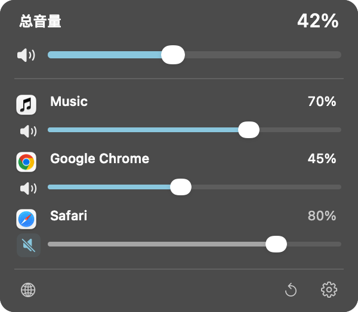
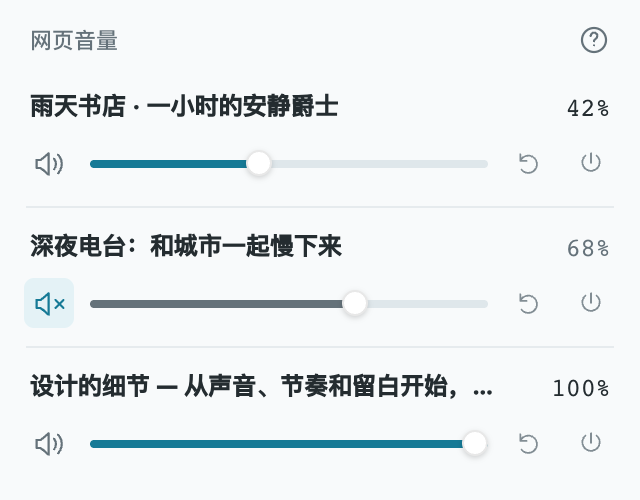

<p align="center"></p>

<h1 align="center">USB Volume</h1>

<p align="center">为 Mac USB 音箱打造的小型原生混音器。</p>

<p align="center"><a href="https://github.com/imboni/usb-volume/releases/tag/v0.3.0">下载 v0.3.0</a> · <a href="https://imboni.github.io/usb-volume/?lang=zh-Hans">官网</a> · <a href="README.md">English</a> · <a href="https://github.com/imboni/usb-volume/issues">反馈问题</a></p>

有些 USB 音箱连接 Mac 后，系统音量滑块无法使用。USB Volume 在菜单栏补上总音量控制，并支持应用独立音量，以及通过配套扩展调节各个网页。音频仅在本机内存中处理。

<p align="center"> &nbsp;&nbsp; </p>
<p align="center"><sub>真实原生界面截图，音源为演示数据。</sub></p>

## 核心功能

- **总音量与静音**：控制所选 USB 音箱的整体输出。
- **应用独立音量与静音**：重新打开应用后恢复设置；能识别归属的浏览器内嵌辅助进程自动合并。
- **网页独立音量**：附带 Chrome / Edge 扩展，分别调节标签页。
- **紧凑原生界面**：300 px 宽，明暗外观、键盘操作、无障碍控件与轻量动效，支持“减少动态效果”。
- **自动检测 USB 音箱**：断开待机、连接询问，可选登录启动、键盘音量键与调节提示音。
- **14 种语言**：应用、浏览器扩展与官网同步支持，包含阿拉伯语从右向左布局。

English · 简体中文 · 繁體中文 · 日本語 · 한국어 · Français · Deutsch · Español · Italiano · Português (Brasil) · Русский · العربية · हिन्दी · Bahasa Indonesia

## 安装

**系统要求：macOS 14.2+、Apple Silicon。** 面向双声道、无输入通道的 USB 输出设备，兼容性因设备而异。发布包为 arm64。

1. [下载安装包](https://github.com/imboni/usb-volume/releases/download/v0.3.0/USBVolume-0.3.0-arm64.zip)，解压，将 **USB 音量.app** 移入“应用程序”。
2. 打开应用。本版采用本机签名，**尚未经过 Apple 公证**；如被阻止，在“系统设置 → 隐私与安全性”中选择“仍要打开”。
3. 连接音箱，启用控制，按提示允许“系统音频录制”。
4. 点击菜单栏图标，从较低音量开始调节。

键盘音量键另需辅助功能权限；本机签名更新后可能需要重新授权。不授权键盘控制也可以使用面板滑块。

[更新记录](CHANGELOG.md) · [SHA-256 校验文件](https://github.com/imboni/usb-volume/releases/download/v0.3.0/SHA256SUMS.txt)

## 日常使用

| 控件 | 功能 |
| --- | --- |
| 顶部滑块 / 扬声器按钮 | 调节总音量 / 总静音。 |
| 各应用滑块 / 扬声器按钮 | 独立调节 / 静音；拖动滑块会取消该应用静音。 |
| 在应用列表滚动 | 浏览列表；按住 **Option** 滚动滑块才调节音量。 |
| 恢复图标 | 全部应用恢复 100% 并取消应用静音，不改变总音量。 |
| 网页图标 | 查看浏览器扩展安装方法和附带文件。 |
| 设置图标 / 右键菜单 | 选择语言、输出设备、自动检测、登录启动和提示音。 |

先播放声音，应用才会被发现；只有输出到所选音箱的应用可以独立调节。总音量与应用音量叠加，应用 **100% 表示不增加额外衰减**。列表定期刷新，新启动的音频进程可能先按总音量播放，再应用已保存的设置。

**退出或暂停控制前，请先暂停播放。** 音箱会恢复原始音量，声音可能变大。已静音应用的独立通道发生异常时，程序会临时静音总输出并显示错误；处理后需手动取消总静音。应用静音用于日常音量控制，不应作为隐私隔离手段。

## 分别控制网页

<p align="center"></p>
<p align="center"><sub>真实扩展弹窗，标签页为演示数据。</sub></p>

1. 点击应用底部的网页按钮，找到附带的 **BrowserExtension** 文件夹，或[下载独立扩展包](https://github.com/imboni/usb-volume/releases/download/v0.3.0/USBVolume-BrowserExtension-0.3.0.zip)。
2. 将文件夹复制或解压到固定位置。
3. 打开 `chrome://extensions` 或 `edge://extensions`，开启“开发者模式”，选择“加载已解压的扩展程序”。
4. 打开普通网页，点击扩展图标，为该标签页启用控制。

需要 **Chrome / Edge 116+**。网页滑块在浏览器扩展弹窗中，暂未同步到 Mac 面板。总音量、浏览器应用音量、网页音量叠加生效；网页设置不会跨浏览器重启保存。扩展以解压包发布，尚未上架浏览器商店。

[扩展安装、权限与测试说明 →](BrowserExtension/README.md)

## 兼容性与隐私

- 面向双声道、只有输出的 USB 设备；不保证多声道、带输入的音频接口及所有软硬件组合兼容。
- 系统原生音量滑块可能仍不可用，请使用 USB Volume 的菜单栏滑块。
- 首次建立应用音频通道可能短暂停顿；其他音频处理软件可能发生冲突。
- Safari 无逐标签页扩展；应用归属取决于 macOS 报告的音频进程，共享 WebKit 辅助进程可能单独显示。
- 系统音频录制权限用于读取播放声音并输出调节后的音频。**不读取麦克风、不保存音频文件、不上传音频**；应用无账号、无遥测。
- 扩展通过本机标签页捕获处理声音；浏览器内部页面和部分受保护媒体无法控制。声音仅在内存中处理，不上传。

如启动时卡住，请先暂停播放，退出应用，重新连接音箱后重试。重启 macOS 音频服务会中断所有应用声音，仅作为手动排查步骤，程序不会自动执行。

## 构建与测试

安装 Apple Command Line Tools（`xcode-select --install`）。应用使用 Objective-C、AppKit 和 CoreAudio，无第三方运行依赖。

```sh
git clone https://github.com/imboni/usb-volume.git
cd usb-volume
bash build.sh
```

生成应用：`build/USB 音量.app`。

```sh
bash test.sh                                 # DSP Sanitizer、路由、按键、检测、本地化
bash test-ui.sh --all-locales                # 14 种语言 × 明暗外观
node --test BrowserExtension/tests/*.test.js # 扩展逻辑与本地化
python3 Tests/ReleaseResources.py            # 版本、文档、图片、语言资源一致性
bash package-release.sh                     # arm64 应用、扩展 ZIP 与校验文件
```

原生 UI 测试需要已登录的 macOS 图形会话，使用模拟音源，不切换真实输出。浏览器交互测试需要 Python Playwright 和 Chrome，见 [贡献指南](CONTRIBUTING.md)。这些测试不能代替真实 USB 音箱和网页捕获的实机验收。

程序支持只读诊断参数 `--status` 和 `--list-devices`。官网为 `docs/` 下的静态 HTML/CSS/JS，通过 GitHub Pages 发布。

## 参与贡献

欢迎提交缺陷、设备兼容性反馈、翻译改进和范围明确的 PR。反馈时请附 macOS 版本、音箱型号、复现步骤及是否运行其他音频处理软件；提交诊断信息前请删除个人数据。

源码目录、翻译方式与测试步骤见 [CONTRIBUTING.md](CONTRIBUTING.md)。

## 开源协议

[MIT](LICENSE) · Copyright © 2026 Boni。
